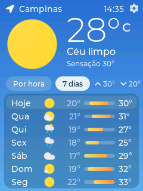
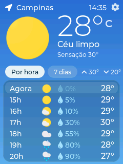
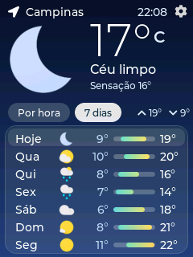
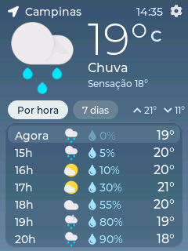
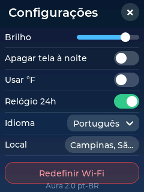
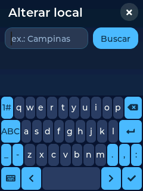
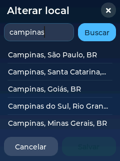
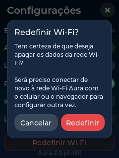
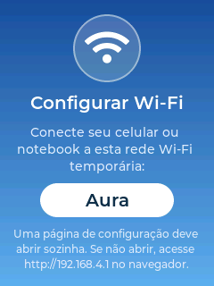
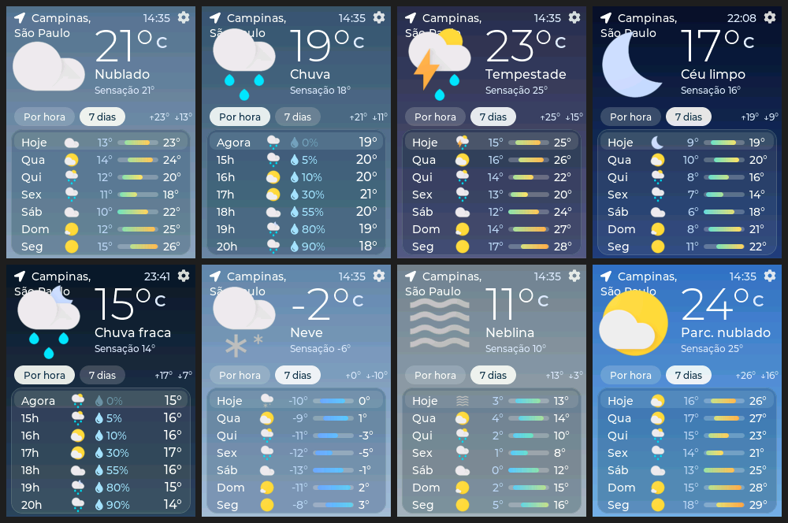

# Aura BR — Estação de tempo para ESP32 CYD

Uma estação de previsão do tempo para a placa **ESP32-2432S028R ("CYD", Cheap Yellow Display)**, com tela de 2,8" (ILI9341, 240×320).
Esta é uma versão **totalmente em português do Brasil e com a interface redesenhada**, tanto na tela do aparelho quanto no instalador.

<p align="center">
  
  
  
  
</p>

> As imagens acima são renderizadas pelo mesmo código de interface do firmware, rodando em um simulador no PC.

## O que há de novo

- **Interface em pt-BR**: textos, dias da semana, condições do tempo e telas de configuração. O português é o idioma padrão (os outros 7 idiomas continuam disponíveis).
- **Visual redesenhado**: fundo em degradê conforme o clima e o período (dia/noite), temperatura grande, sensação térmica, máxima e mínima do dia.
- **Abas "Por hora" e "7 dias"**, com barras de temperatura coloridas na previsão semanal.
- **Configurações renovadas**: brilho, modo noturno, °F, 24h, idioma, trocar cidade e redefinir Wi-Fi.
- **Busca de cidade** com teclado na tela e lista de resultados.
- **Tela de configuração do Wi-Fi** com passo a passo.
- **Padrões brasileiros**: cidade São Paulo, formato 24h, português.
- **Instalador web em pt-BR** (`docs/`), com versão normal e de cores invertidas.

<p align="center">
  
  
  
  
  
</p>

<p align="center">
  
</p>

## Como instalar (sem compilar)

**Opção 1 — Instalador web** (Chrome ou Edge no computador):
abra a página do projeto no GitHub Pages (`Settings → Pages → Branch: main, pasta /docs`), conecte a placa por um cabo USB **de dados** e clique em **Conectar e instalar**.
Se as cores aparecerem erradas, use a versão **"Cores invertidas"**.

**Opção 2 — Arquivos `.bin`**: baixe em [Releases](../../releases) (ou em `docs/bin/`) e grave o arquivo *merged* no offset `0x0` com o esptool:

```bash
esptool.py --chip esp32 --baud 460800 write_flash 0x0 aura-ptbr.bin
```

## Primeiro uso

1. Ligue a placa. Ela cria a rede Wi-Fi **Aura**.
2. Conecte o celular a essa rede; o portal abre em `192.168.4.1`.
3. Escolha sua rede Wi-Fi e digite a senha.
4. Toque na engrenagem ⚙ para escolher a cidade e ajustar as opções.

## Compilar o firmware

Requisitos: ESP32 core **3.2.0**, bibliotecas **LVGL 9.2.2**, **TFT_eSPI**, **WiFiManager** e **ArduinoJson 7**; partição *Huge APP*.

1. Copie `firmware/config/lv_conf.h` para `libraries/lvgl/src/` e `firmware/config/User_Setup.h` para `libraries/TFT_eSPI/`.
2. Abra `firmware/weather/weather.ino` na Arduino IDE (ou use `arduino-cli`) e compile para *ESP32 Dev Module* com a partição *Huge APP*.
3. Para a versão de **cores invertidas**, descomente `#define TFT_INVERSION_ON` no `User_Setup.h`.

As fontes embutidas foram geradas com `firmware/gerar_fontes.sh` (inclui acentos do português).

## Estrutura

| Pasta | Conteúdo |
|---|---|
| `firmware/weather/` | Código do firmware (`weather.ino` = rede/Wi-Fi/toque, `ui.cpp` = interface LVGL, `translations.h` = idiomas) |
| `firmware/config/` | `lv_conf.h` e `User_Setup.h` usados na compilação |
| `docs/` | Instalador web em pt-BR, imagens e binários |

## Limitações

- Não testado em todas as variações da placa; a primeira gravação em hardware real é o teste final.
- A página do portal Wi-Fi (biblioteca WiFiManager) e a janela do ESP Web Tools continuam em inglês.

## Licença e créditos

O código do firmware é licenciado sob **GPL 3.0** (ver `LICENSE`). Os ícones **não** estão cobertos por essa licença e mantêm os termos dos seus autores (google-weather-icons).

---

**Este projeto é um clone melhorado do [Surrey-Homeware/Aura](https://github.com/Surrey-Homeware/Aura)**, com interface redesenhada e tradução para o português do Brasil. Todo o crédito pela ideia e pela base do código vai para os autores originais.
